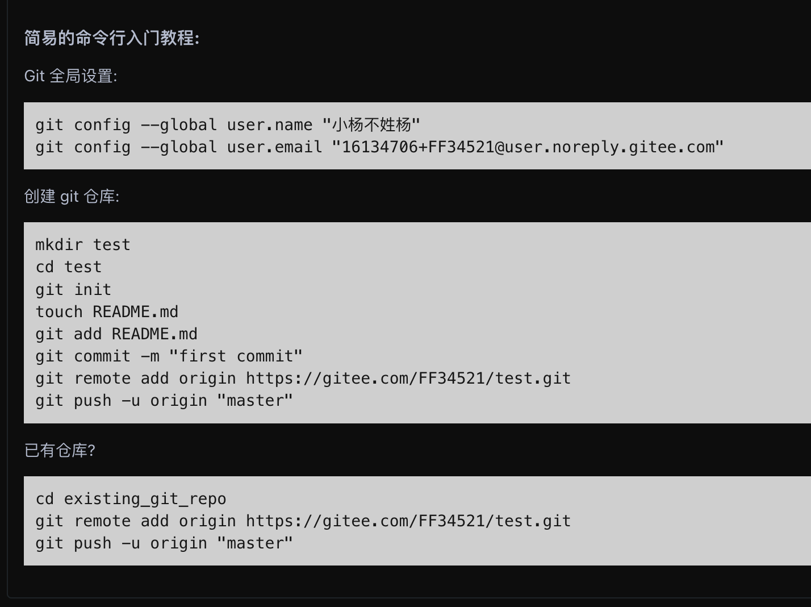

## **git**

#### 什么是`git`
涉及到这个问题我们首先要了解一个概念————版本控制工具，嗯计算机是这样的，每次都会看见很多高大上的名词和一堆看不懂的概念，希望各位不要害怕，先安心学下去。

#### 版本控制工具 
版本控制是一种软件工程技术，用于记录文件、目录或项目的修改历史，以便在未来查看、恢复或管理特定版本的内容。它是开发过程中不可或缺的工具，尤其在多人协作开发中，能够有效地管理代码和文档的变更。

版本控制的核心功能是通过对文件的每次修改拍摄快照，保存这些快照以便随时回溯到之前的状态。这种机制不仅适用于代码，还可以用于任何类型的文件.
`(取自于必应)`

简单来说，版本控制工具在团队开发中有两个主要作用：

1. 帮助快速修正项目中的错误，并且记录修改历史，可以通过回溯解决问题
2. 允许团队成员在不互相干扰的情况下独立工作，通过机制整合代码

#### 分类 

##### 本地版本控制工具
##### 集中式版本控制`(CVCS)`
##### 分布式版本控制`(KSV)`


`git`属于这里的分布式版本控制也是用的比较多的。我们后续的任务提交，都需要各位用到这个功能
好，我们开始说正题。

#### `git`

##### 起点 
==从官网上去下载`git`==

###### `WINDOWS系统`
如果你是`Windows`电脑，请按照下面的流程

1. 下载
   链接地址 : https://github.com/git-for-windows/git/releases/download/v2.51.0.windows.1/Git-2.51.0-64-bit.exe 
    当然 如果懒得自己下载或者觉得下载速度过慢，可以直接解压下载我这里压缩包当中的 也是最新版本的，解压然后直接下载即可。
2. 安装
    在看到`where shoule Git be installed`字样 手动更改安装路径 
    切记 ==不要不要不要装在C盘 ！！！！！==
    然后 `next` 勾选 `Additional Icons` 和 `Add a Git Bash Profile for Windows Terminal` 前者的目的是创建一个桌面图标(不喜欢可以不勾选，建议勾选)，后者是说把`git`功能集成到`Windows` 的终端`cmd(命令行)`里，之后一路`next`就可以安装成功了

```
    如果有比较细心的同学可能会注意到网站的页面当中提供了两种选择 一种是 X64 另一种是 arm64架构 一般来说 x64架构是Windows系统当中比较常见和通用的架构，对于不同电脑的适配性比较好，并且更注重性能。当然具体情况还是要根据自己电脑的具体架构来看。 
    而ARM64更看重续航 和一些办公的轻度使用。

    还有一种更老的x86架构，主要是为了32位操作系统服务的。现在已经很少有32位的操作系统了。上面的两种都是一种64位的拓展。    
```
###### `MacOS系统`
如果你是macOS用户的话，请首先下载`homebrew`  如果觉得下载过慢，可以使用国内镜像下载。然后在终端使用
```
brew install git 
```
等进度条跑完就下载完成了。然后的话，可以安装一下Mac自带的开发者工具链 
```
xcode-select --install
```
上述两种方式就都可以安装到`git` 

---

无论是什么系统，在安装完成之后`Windows系统`当中就使用`win+R`然后输入`cmd`进入到命令行，或者直接搜命令提示符，然后输入下面的命令。
```
git --version 
```
如果能够看到输出正确的版本号，那就表示`git`已经安装成功了，
注意 : ==命令里的空格不能省略！！！==
<u>敲完命令之后按回车也就是`enter`就会执行了</u>

#### 应用 

一般来说我们需要用`git`这个工具把我们写的代码托管到代码托管平台上。目前市面上最受欢迎和用的最多的就是`github`。当然还有很多主流的比如`gitcode`、`gitlab`、`gitee`，以及开放原子等多平台。我们这次主要先用`gitee`来作为教程使用。由于某些科学不可言说的理由，`github`有的时候可能会出现无法访问的情况。

`gitee`可以理解成国内的`github`，对于国内比较友好

##### 1、配置`git`个人信息

`Windows系统`使用`win+R`输入cmd
`MacOS`直接打开终端 
然后输入下面的命令 
```python
git config --global user.name  "把你想起的名字写在这里"
git config --global user.email  "你的邮箱"
#这里别照抄我的字，是把自己的昵称和邮箱写到引号内部！
```
注意 : 上面的命令都是一行之后回车，不要一起打进去。也不要自己改命令，和上面完全一致。==空格也不能省略！！！==

##### 2、获取和配置ssh秘钥
首先来获取公钥
```python
ssh-keygen -t rsa -C "你的邮箱"
# -t rsa是按照RSA算法规则生成密钥  -c 是备注 内容一般是写邮箱 
```
执行之后会先问保存位置，直接回车会存在默认位置 后面会问要不要设置密码，看喜好，推荐直接回车即可。 
 一般会在C盘里用户 然后进到你自己用户名的文件夹 然后在查看中显示隐藏文件会有一个隐藏文件夹`.ssh`所有以`.`开头的文件夹都是隐藏的
然后会看见两个文件 一个名字里带着`_pub`的就是我们要找的公钥，打开 复制下来


##### 3、添加到远程仓库
然后把公钥添加到上面的远程仓库里 
这里以`gitee`为例 

进入`账号设置-> 安全设置 -> SSH公钥`
然后粘贴刚刚复制的公钥。起个名字
添加了之后可以测试一下 
```
ssh -T git@gitee.com
```
这里执行过程中会询问是否要进行连接，按照提示输入`yes`完成连接就可以了


#### 创建仓库以及怎么上传


##### 创建
首先要知道`git`的几个基本命令
本地`git`当中分为三个部分 
1. 未提交状态
2. 送入暂存区准备提交状态
3. 提交后进入仓库

```python
git init # 在当前文件夹下初始化一个git仓库


git  add . # 提交当前文件夹下的所有文件进入暂存区 

git commit -m "注释" # 提交所有暂存区内的内容

# 如果你不清楚目前什么文件处于什么状态，可以使用
git status # 显示当前目录下所有变动和待提交的状态

git log # 显示你之前做了什么 一个日志
```

知道了上面这些之后，我们只有一个本地仓库也不行，我们可以在gitee上创建一个新仓库。
1. 选择仓库权限 为 **公开** 或者是 **私有** 

```
关于私有权限，可以当做是，朋友圈里的部分可见，这里的部分指的是自己 和 邀请进来参与的协作者或者同一个组织的组织成员
```

2. 一开始尝试可以不用初始化，也可以不用放`readme`和`gitignore`这些
创建完成之后会得到下面这一张图。


如果已经在本地完成了上面创建本地仓库的操作可以选择按照已有仓库的这条来进行操作

如果没有可以参照第二个来操作。
基本到这里创建操作也完成了

##### 上传
通常上传是已经在本地提交了。为了保证远程的版本是不高于本地的，所有的新的修改都可以在本地完成
```python
# 如果现在要进行上传我本地已经提交过了的文件
git push -u origin "仓库链接"
# 如果先前没有绑定一个远程仓库需要先添加一个远程仓库 
git remote add origin "仓库链接"
```

#### 常用基本操作
关于常见的命令熟练可以去玩一下
下面这个游戏，里面做到了命令可视化，对于常见命令都有涉及到，可以帮助快速掌握和理解。

https://learngitbranching.js.org/?locale=zh_CN


#### git可视化软件
新手一般能用命令行还是尽量使用命令行来操作，如果想搞的炫酷或者看着方便也推荐几个带图形化界面的去折腾
sourcetree  https://www.sourcetreeapp.com/

tortoisegit https://tortoisegit.org/

git gui 这个是 安装之后 git 自带的