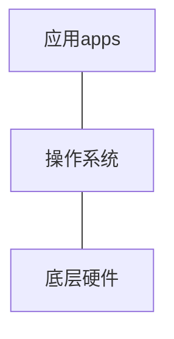

## 引入
大家之前应该或多或少都接触过。提交的文件，比如说.docs 或者 .pdf 和 .pptx这种文件。我们代码也是需要存储到文件里，其实代码文件本质上也就是一个文稿文件.txt。这两个某种程度上一样，只不过。

代码可以通过一种手段变成机器码。 这种手段叫编译。 所以写的代码需要通过编译之后才能够被计算机认识。但是这个过程会用到什么呢

## 计算机是由什么部分组成的 
计算机最开始的用途就是用来让人更加便利的处理计算。那一定有模块需要用于计算领域，这个名字想必大家也一定听到过，就是`CPU`

### CPU 
全称 叫 `central processing unit`中央核心处理单元。
主要负责运算和执行基本的指令。整台计算机的核心大脑。

既然有了计算模块，计算的结果需要被存储起来啊，那就需要主要负责存储的模块。
### RAM 和 ROM 
`RAM`指的是随机存储器`(random access memory)`，表示一种快速暂时的随机存储机制，掉电不会保存。 相对应的也就出现一种长期存储 
`ROM` 指的是只读存储器 `(read-only memory)` 要存储的内容通过RAM写入到硬盘中，这样哪怕断电了之后也可以存储了。

到这里为止，都是硬件，只有这些东西还不能让你的计算机在你长按开机键之后亮起来屏幕，那就需要另一个东西。
### 操作系统 `OS`
`operating system`这可能是大多数人接触过最多的软件，提到这个名词可能很陌生，那下面应该不陌生了，`Windows MacOS Android IOS`这些都是常见的计算机和手机 平板上的操作系统。**操作系统也是软件。** 和后面可能了解的`Linux系统`
你的电脑在按下开机键之后会量显卡的标，然后可以进入`BIOS` 在之后就是进入操作系统了。 

整体的结构其实是 

这幅图描述的就是你在手机上用的所谓应用程序都是在操作系统的上层，而操作系统则是建立在底层物理硬件的上层。

这里要提到两个概念 ==进程和线程==  
`进程`: 运行中的程序就是进程
比如你在手机或者电脑上启动运行一个软件或者程序就是单独开了一个进程
与之相对应的`线程`则是CPU调度当中的最小单位，是进程内部的一条执行路径

## 文件和路径 
文件会因为各自拓展名不同而出现不同的格式和不同的用途
我们存放文件夹就需要有路径 也就出现了绝对路径和相对路径 
路径有两种，一种叫绝对路径 比如 
```shell 
macOS/Linux：
/Users/zhangsan/Desktop/code/main.py

Windows：
C:\Users\zhangsan\Desktop\code\main.py
```
这种把所有路径都显示出来的就叫做绝对路径，
而相对路径是什么呢
假设你当前已经位于 code文件夹下在这个文件夹下 有一个文件叫，`main.py`
```
./main.py
```

## gui 和 终端 
正常来说，我们会使用图形的文件夹然后进行文件的拖动等相关操作这种通常来说是使用图形化界面来操作计算机，也叫`GUI `龟 或者`graphic user interface` 图形化用户接口 
那自然就会有另外一种没有图的，那种叫 终端。也叫 `terminal`
终端一般来说通用的语言是`shell`,哦没错操作终端也需要一种语言。也算是有自己的语法 一般用来写脚本`script`
常用的终端命令如下 
```shell
. #当前文件夹
.. #上一级文件夹 
ls  #展示当前目录下的 所有文件 
ls -a #展示当前目录下的所有文件包括隐藏文件
pwd # 显示当前路径 绝对路径
cd # 进入某个路径下 
touch  filename.txt # 创建一个文件叫 filename.txt
mkdir folder # 创建一个文件夹叫foler
rm  # 删除 
rm -f # 强制删除
rm -r # 递归删除
```

## 语言发展历程
简要介绍一下
程序员编程最开始是在纸条上打孔，表示0和1 。然后到了20世纪50年代，汇编语言出现了，程序员开始使用汇编 来进行编程。在之后由开发了`Unix`系统的贝尔实验室开发了一门语言叫`Visual Basic`或者简称`B`语言。

### 跨时代的 C
B 之后开发了C语言，解决了B中不够简洁的一些问题，优化了语法。
unix 系统 算是`Linux`的前身。
linus 把自己的操作系统源码发到了网上 然后很多人给他发邮件提交代码。就构成了现在应用最广泛的一个操作系统 `linux` 
数据库 - `sqlite` 手机和一些硬件和操作系统的

编程范式 语言的设计要求 
C语言 高级语言 - 低级语言 控制能力`指针`
内存控制 面向过程语言 
function ? 

Cpp 带着面向对象出现了  
cpp 让人又爱又恨。游戏 `unity`
`ue5` 主要应用写游戏引擎。 做系统底层
音视频开发 视频协议  ffmpeg  编译型语言 

`Java` 面向对象的集大成者  编译型  虚拟机  javac 
做后端岗位 Java 国内阿里  
完善的面向对象的体验。
生态在国内外都比较完善 
帮你做一些web应用 或者医院系统 管理系统 

`ts`
`python`当下比较热门 纯解释型语言 cpython c
- 机器学习 
- 正常web开发 flask  django 
- AI 练模型 
- 爬虫

---
后端 - 处理数据 - 数据库 
读写操作文件的能力。

前端 -从后端拿数据反馈到页面上。
设计美感 

javascript 弱类型

``` js
let a = 'hello world';
console.log(a);
```
html 
css 
框架做  vue react 

typescript  超集 强类型 
是目前比较主流的做agent开发相关的语言 

`dsh`
`codex` 

## 什么是配环境
环境 - 语言运行环境 
两样东西就可以 把代码跑通 文本编辑器 + 编译器 
就是去官网下载一个编译器和其他语言自带的动态链接库。